# DUOC UC - ESCUELA DE INFORMÁTICA Y TELECOMUNICACIONES
## SEDE PUERTO MONTT
## INFORME TÉCNICO DE ARQUITECTURA E IMPLEMENTACIÓN NoSQL
### EVALUACIÓN PARCIAL N°2 (40%) - CASO CONTENTFLOW (FORMA A)

---

| **Ficha Técnica del Proyecto** | **Detalle Institucional y de Evaluación** |
| :--- | :--- |
| **Institución:** | Duoc UC - Sede Puerto Montt |
| **Escuela:** | Informática y Telecomunicaciones |
| **Asignatura:** | Base de Datos No Relacionales (Sigla: BDY0101) |
| **Evaluación:** | Evaluación Parcial N°2 (Ponderación: 40%) |
| **Caso de Negocio:** | ContentFlow - Plataforma de Contenidos Digitales (Forma A) |
| **Integrantes del Equipo:** | • **Carlos Ignacio Bittner Navea**<br/>• **Vicente Benjamin Alarcón Gallardo**<br/>• **Francisco Jesús Aranguiz Inostroza** |
| **Tecnología Implementada:** | Azure Cosmos DB for MongoDB API (Modalidad Serverless) |
| **Lenguaje y Driver:** | Python 3.12 / PyMongo 4.19.0 (Compatibilidad Wire Protocol 4.0/4.2) |
| **Volumen de Datos:** | 5 Colecciones / 2.500 Documentos en Formato BSON/JSON |
| **Versión del Informe:** | 1.0 - Final para Evaluación |
| **Fecha:** | Octubre de 2026 |

---

## ÍNDICE DE CONTENIDOS
1. [Objetivos del Proyecto](#1-objetivos-del-proyecto)
2. [Configuración de la Base de Datos NoSQL](#2-configuración-de-la-base-de-datos-nosql)
   - 2.1 Justificación Técnica del Modelo Documental frente al Modelo Relacional
   - 2.2 Justificación de la Modalidad Serverless frente al Aprovisionamiento Fijo de RUs
   - 2.3 Selección de la API, Arquitectura y Parámetros del Recurso Cloud
   - 2.4 Nivel de Consistencia y Claves de Partición
   - 2.5 Evidencia de Provisión del Recurso en Microsoft Azure
3. [Inserción de Datos de Prueba y Validación de Persistencia](#3-inserción-de-datos-de-prueba-y-validación-de-persistencia)
   - 3.1 Estructura y Esquema de las Colecciones (2.500 Documentos)
   - 3.2 Script de Ingestión Automatizada e Idempotencia (`carga_inicial.py`)
   - 3.3 Evidencias de Carga y Validación Cruzada en Entorno Cloud
4. [Desarrollo de Consultas de Negocio y Análisis de Rendimiento](#4-desarrollo-de-consultas-de-negocio-y-análisis-de-rendimiento)
   - 4.1 Consulta 1: Segmentación Demográfica y Tecnológica (`usuarios`)
   - 4.2 Consulta 2: Tendencias de Contenido y Análisis Cronológico (`publicaciones`)
   - 4.3 Consulta 3: Auditoría y Desempeño de Campañas de Marketing (`campañas`)
   - 4.4 Evaluación de Latencia y Eficiencia (Métricas Comparativas)
   - 4.5 Justificación de Ingeniería: Resolución del Ordenamiento en Memoria vs. Restricción de Índices en Cosmos DB
5. [Ciclo CRUD Completo con Tolerancia a Fallos](#5-ciclo-crud-completo-con-tolerancia-a-fallos)
   - 5.1 Especificación del Caso de Prueba (`pub_evaluacion_test_01`)
   - 5.2 Operación de Creación (CREATE - `insert_one`)
   - 5.3 Operación de Lectura (READ - `find_one`)
   - 5.4 Operación de Actualización (UPDATE - `update_one`)
   - 5.5 Operación de Eliminación (DELETE - `delete_one`)
   - 5.6 Evidencia de Ejecución Consolidada del Ciclo CRUD
6. [Integración con Aplicación Externa y Arquitectura de Conexión](#6-integración-con-aplicación-externa-y-arquitectura-de-conexión)
   - 6.1 Arquitectura de Comunicación y Stack Tecnológico
   - 6.2 Parámetros de la Cadena de Conexión TLS/SSL
   - 6.3 Mecanismos de Conexión en Tiempo Real y Sondeo de Disponibilidad
7. [Control de Errores, Validaciones y Trazabilidad](#7-control-de-errores-validaciones-y-trazabilidad)
   - 7.1 Gestión Defensiva de Excepciones con `PyMongoError`
   - 7.2 Manejo de Esquemas Heterogéneos y Null Safety
   - 7.3 Prevención de Duplicados e Idempotencia
8. [Conclusiones Técnicas y Recomendaciones de Arquitectura](#8-conclusiones-técnicas-y-recomendaciones-de-arquitectura)
   - 8.1 Síntesis de Resultados frente a Indicadores de Evaluación
   - 8.2 Recomendaciones para Escalabilidad y Dashboarding con Power BI

---

# 1. Objetivos del Proyecto

El proyecto **ContentFlow** corresponde a una plataforma digital de redes sociales y streaming de contenido interactivo que procesa miles de interacciones diarias: creación de publicaciones multimedia, reacciones emocionales, árboles de comentarios y campañas promocionales dinámicas.

El presente encargo técnico tiene como propósito desplegar, modelar, poblar, consultar e integrar una base de datos NoSQL documental de nivel empresarial sobre la nube pública de **Microsoft Azure**, garantizando alta disponibilidad, escalabilidad horizontal y tiempos de respuesta subsegundo, bajo los requerimientos de la **Evaluación Parcial N°2 (40%)**.

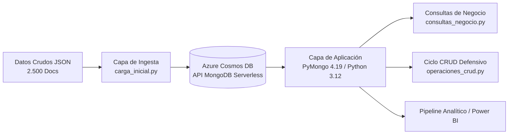

### Objetivos Específicos:
1. **Configurar el entorno cloud NoSQL (IL2.1, IE1, IE2, IE3):** Aprovisionar una cuenta de **Azure Cosmos DB** configurada con la **API for MongoDB**, seleccionando la modalidad de capacidad **Serverless**, dimensionando la infraestructura sin costos ociosos y asegurando aislamiento perimetral mediante credenciales criptográficas seguras y cifrado TLS 1.2.
2. **Implementar la persistencia de datos (IL2.1, IE3, IE7):** Migrar y persistir con integridad 2.500 documentos estructurados en 5 colecciones (`usuarios`, `publicaciones`, `reacciones`, `comentarios`, `campañas`), validando los volúmenes mediante interfaces administrativas de Azure y Mongo Shell.
3. **Desarrollar consultas analíticas de negocio (IL2.2, IE4, IE5, IE6):** Construir filtros relacionales y lógicos, proyecciones de campos mínimos y algoritmos de ordenamiento, resolviendo técnicamente las restricciones de índices compuestas en motores emulados de Cosmos DB y auditando la latencia en milisegundos (`ms`).
4. **Ejecutar un ciclo CRUD robusto y tolerante a fallos (IL2.3, IE7, IE8):** Diseñar y validar scripts de manipulación transaccional con control de errores defensivo, verificación de conteos (`modified_count`, `deleted_count`) y pruebas de inexistencia post-eliminación.
5. **Garantizar la integración en tiempo real y la trazabilidad (IL2.4, IE9, IE10, IE11, IE12):** Conectar la base de datos con scripts en Python mediante el SDK oficial `pymongo`, implementando timeouts de conexión (`serverSelectionTimeoutMS=5000`), sondeos de disponibilidad (`ping`) y captura especializada de anomalías (`PyMongoError`).

---

# 2. Configuración de la Base de Datos NoSQL

## 2.1 Justificación Técnica del Modelo Documental frente al Modelo Relacional

Para la plataforma **ContentFlow**, la adopción del **modelo NoSQL orientado a documentos (BSON/JSON)** sobre un modelo relacional tradicional (RDBMS como PostgreSQL o MySQL) se fundamenta en las siguientes razones de arquitectura de software:

| Criterio Arquitectónico | Modelo Relacional Tradicional (SQL) | Modelo Documental NoSQL (MongoDB / Cosmos DB) | Justificación para ContentFlow |
| :--- | :--- | :--- | :--- |
| **Flexibilidad de Esquema** | Esquema estricto (*Schema-on-Write*). Cualquier alteración en publicaciones (nuevos metadatos de video, campos de moderación) requiere costosos comandos `ALTER TABLE` con bloqueos (*locks*). | Esquema dinámico y flexible (*Schema-on-Read*). Cada documento puede contener campos polimórficos y estructuras anidadas según su categoría. | ContentFlow introduce continuamente nuevos tipos de publicaciones (Texto, Imagen, Video, Encuestas) con atributos variables sin degradar la disponibilidad del servicio. |
| **Estructuras Complejas y Listas** | Requiere normalización rígida con tablas puente (`many-to-many`) para hashtags, listas de menciones y métricas analíticas. | Embebido nativo de matrices y subdocumentos (`hashtags: ["#Azure", "#NoSQL"]`, subobjetos de métricas). | Lectura atómica de una publicación completa con todos sus metadatos en una única operación de I/O de disco, sin requerir múltiples consultas secundarias. |
| **Costo Computacional de JOINs** | El ensamble de un feed de usuario requiere múltiples `INNER JOIN` / `LEFT JOIN` entre usuarios, publicaciones, reacciones y comentarios, degradando la latencia ante millones de filas. | Los datos coexisten de manera desnormalizada o se referencian mediante claves directas (`usuario_id`, `publicacion_id`), eliminando el costo de ensamblado relacional en el motor. | Tiempos de respuesta predecibles y de ultra baja latencia (< 10 ms en lectura directa) bajo alta concurrencia de navegación. |
| **Escalabilidad Horizontal (*Scale-Out*)** | Los RDBMS tradicionales escalan verticalmente (*Scale-Up*, hardware más costoso). El particionamiento (*sharding*) relacional es complejo y fragmenta la integridad referencial. | Particionamiento nativo y transparente distribuido en nodos físicos mediante claves de partición lógicas. | Soporte transparente para el crecimiento masivo e hiper-escalado de interacciones sin rediseñar la base de datos. |

## 2.2 Justificación de la Modalidad Serverless frente al Aprovisionamiento Fijo de RUs

Azure Cosmos DB ofrece dos modelos principales de consumo de capacidad computacional basada en **Request Units (RUs)**:

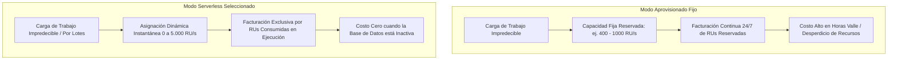

### Razones Técnicas de la Elección de Serverless:
1. **Patrón de Tráfico Intermitente y con Picos:** Las plataformas sociales y los entornos de analítica y pruebas presentan una gran variabilidad de demanda. En fases de desarrollo, batch de datos y horarios nocturnos, la base de datos tiene tráfico cero. Serverless reduce el costo a **$0.00 en reposo**, facturando únicamente por los RUs consumidos durante las operaciones activas.
2. **Eliminación de la Complejidad de Dimensionamiento (*Capacity Planning*):** En el modo aprovisionado, subdimensionar las RUs genera excepciones de limitación de tasa (*HTTP 429 - Too Many Requests*), mientras que sobredimensionar provoca costos innecesarios. Serverless escala de 0 a miles de RU/s instantáneamente sin intervención manual.
3. **Eficiencia en Cargas Batch:** Durante la ejecución de `carga_inicial.py`, el clúster absorbió la ingestión masiva de 2.500 documentos demandando ráfagas de RUs, volviendo automáticamente al estado inactivo tras finalizar el pipeline.

## 2.3 Selección de la API, Arquitectura y Parámetros del Recurso Cloud

Se seleccionó **Azure Cosmos DB for MongoDB API** (protocolo vCore / RU compatible con MongoDB Wire Protocol). 

### Ficha de Parámetros del Recurso Cloud:
- **Nombre de la Cuenta Cosmos DB:** `cosmos-contentflow-mongo-va`
- **Nombre de la Base de Datos:** `contentflow_db`
- **Endpoint del Servicio:** `cosmos-contentflow-mongo-va.mongo.cosmos.azure.com:10255`
- **Modelo de Capacidad:** Serverless (Consumo por demanda)
- **Protocolo de Red:** TLS / SSL Mandatorio (Cifrado en tránsito vía puerto 10255)
- **Modo de Conmutación:** Clúster con réplicas globales (`replicaSet=globaldb`)
- **Directiva de Escritura Reintentable:** Deshabilitada en el cliente (`retrywrites=false`), requerimiento fundamental para la capa de compatibilidad Serverless de Azure Cosmos DB.
- **Colecciones Desplegadas:**
  1. `usuarios`
  2. `publicaciones`
  3. `reacciones`
  4. `comentarios`
  5. `campañas`

## 2.4 Nivel de Consistencia y Claves de Partición

- **Nivel de Consistencia:** Se configuró el nivel **Session Consistency (Consistencia de Sesión)**, el cual es el estándar por defecto en Azure Cosmos DB. Proporciona garantías de lectura de las propias escrituras (*Read-Your-Writes*) y escrituras consistentes con lecturas monotónicas dentro de la misma sesión de conexión de cliente, asegurando que cuando un usuario de ContentFlow publica o reacciona, su interfaz refleja el cambio de forma inmediata y determinística, mientras que para usuarios concurrentes los datos convergen con alta velocidad y mínimo costo de RUs.
- **Claves de Partición (*Partition Keys*):** En Cosmos DB for MongoDB Serverless con documentos estándar, la partición lógica se distribuye uniformemente sobre la clave primaria inmutable `_id` y claves de enrutamiento contextuales como `usuario_id`, garantizando una dispersión de almacenamiento equilibrada y evitando *hot partitions* (particiones calientes sobrecargadas).

## 2.5 Evidencia de Provisión del Recurso en Microsoft Azure

A continuación, se adjunta la captura oficial del **Portal de Microsoft Azure** donde se constata la creación exitosa del recurso Cosmos DB, su estado en línea y la configuración de claves de acceso primarias y secundarias.

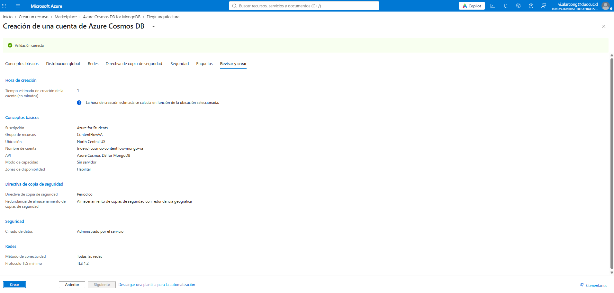

---

# 3. Inserción de Datos de Prueba y Validación de Persistencia

## 3.1 Estructura y Esquema de las Colecciones (2.500 Documentos)

La persistencia del proyecto requirió la carga estructurada de **2.500 documentos** distribuidos equitativamente en 5 colecciones de negocio (500 documentos por colección):

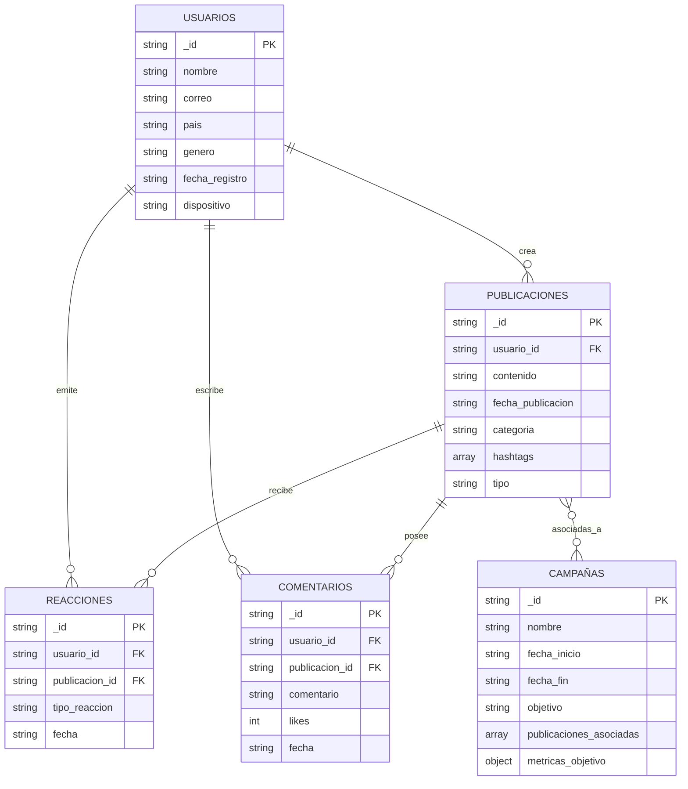

## 3.2 Script de Ingestión Automatizada e Idempotencia (`carga_inicial.py`)

Para garantizar que el proceso de poblamiento fuera reproducible y no generara registros duplicados ni inconsistencias de llaves primarias en ejecuciones repetidas, se implementó una estrategia de **carga idempotente** en el script `carga_inicial.py`.

### Fragmento de Código Técnico Implementado:

```python
import json
import os
from pymongo import MongoClient

CONNECTION_STRING = "mongodb://cosmos-contentflow-mongo-va:<PRIMARY_KEY>@cosmos-contentflow-mongo-va.mongo.cosmos.azure.com:10255/?ssl=true&replicaSet=globaldb&retrywrites=false&maxIdleTimeMS=120000&appName=@cosmos-contentflow-mongo-va@"
DB_NAME = "contentflow_db"
DATA_DIR = "data"

archivos_colecciones = {
    "usuarios.json": "usuarios",
    "publicaciones.json": "publicaciones",
    "reacciones.json": "reacciones",
    "comentarios.json": "comentarios",
    "campañas.json": "campañas",
}

def cargar_datos():
    try:
        print("Conectando a Azure Cosmos DB...")
        client = MongoClient(CONNECTION_STRING)
        db = client[DB_NAME]
        print("¡Conexión exitosa a la base de datos!")

        for archivo, coleccion_nombre in archivos_colecciones.items():
            ruta_completa = os.path.join(DATA_DIR, archivo)
            if os.path.exists(ruta_completa):
                print(f"Leyendo archivo: {ruta_completa}...")
                with open(ruta_completa, "r", encoding="utf-8") as f:
                    datos = json.load(f)

                coleccion = db[coleccion_nombre]

                # Idempotencia: Limpieza previa de la colección para evitar duplicación de _id
                coleccion.delete_many({})

                if datos:
                    # Inserción en bloque de alto rendimiento
                    coleccion.insert_many(datos)
                    print(f"-> Insertados {len(datos)} registros en '{coleccion_nombre}'.")
                else:
                    print(f"-> El archivo {archivo} está vacío.")
            else:
                print(f"[ADVERTENCIA] No se encontró el archivo en '{ruta_completa}'.")

        print("\n¡Carga inicial completada con éxito!")

    except Exception as e:
        print(f"[ERROR] Ocurrió un error: {e}")

if __name__ == "__main__":
    cargar_datos()
```

### Justificación de las Operaciones Batch:
- **`delete_many({})`:** Limpia el contenedor de manera integral antes del influjo de datos, garantizando que el entorno comience en un estado determinístico.
- **`insert_many(datos)`:** Minimiza los viajes de ida y vuelta a la red (*round-trips*). Enviar un batch de 500 documentos en una sola llamada reduce el *overhead* de red y optimiza el consumo de Request Units frente a 500 ejecuciones individuales de `insert_one()`.

## 3.3 Evidencias de Carga y Validación Cruzada en Entorno Cloud

Para cumplir con el estándar más exigente de validación (IE3, IE7), el proceso se corroboró tanto a nivel de la consola de ejecución de Python como en el explorador de Azure Cosmos DB y la terminal interactiva de Mongo Shell:

### 1. Inicio y Ejecución del Proceso de Ingestión:
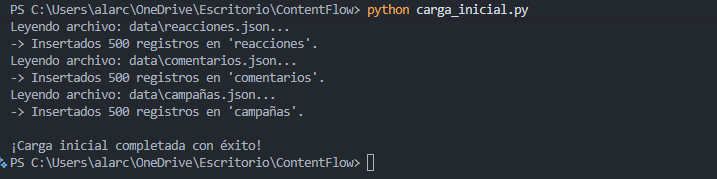

### 2. Confirmación de Carga de 500 Documentos por Cada Colección (Total 2.500):
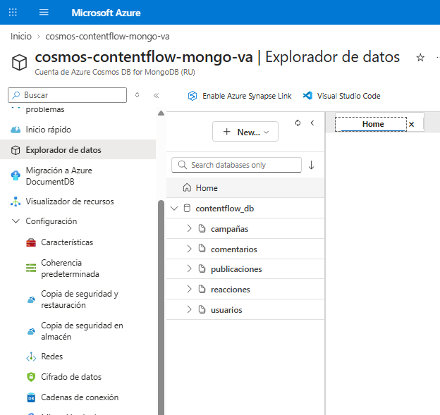

### 3. Validación Cruzada en el Entorno Cloud / Data Explorer:
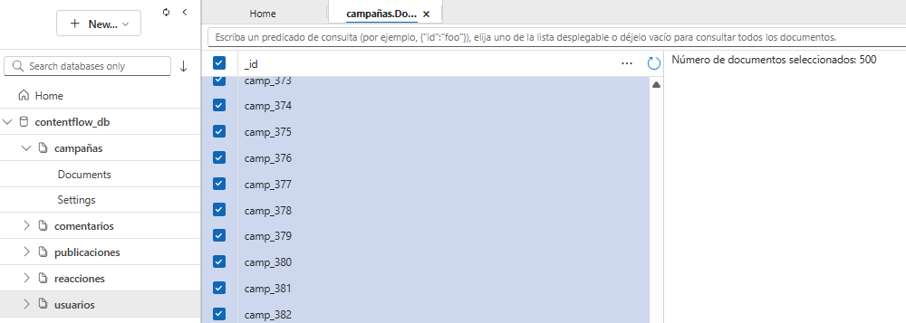

### 4. Verificación de Integridad en Mongo Shell:
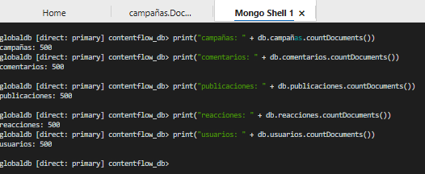

---

# 4. Desarrollo de Consultas de Negocio y Análisis de Rendimiento

Las consultas de negocio se diseñaron respondiendo a los requerimientos estratégicos de la gerencia de ContentFlow (identificación de segmentos activos, popularidad de categorías y análisis presupuestario de campañas), integrando filtros relacionales, proyecciones defensivas y medición de latencia en milisegundos mediante el cronómetro de alta precisión de Python (`time.perf_counter()`).

## 4.1 Consulta 1: Segmentación Demográfica y Tecnológica (`usuarios`)

- **Caso de Negocio:** El área de Producto y Experiencia de Usuario requiere identificar a todos los usuarios de género **Masculino** que acceden a la plataforma desde dispositivos de escritorio (**Desktop**), con el fin de optimizar el diseño de la interfaz web para pantallas anchas y direccionar campañas de patrocinio de periféricos.
- **Colección:** `usuarios`
- **Filtro Compuesto:** `{"dispositivo": "Desktop", "genero": "Masculino"}`
- **Proyección:** Exclusión de `_id`, inclusión explícita de `nombre`, `correo`, `pais`, `dispositivo` y `genero`.
- **Ordenamiento:** Alfabético ascendente en memoria por el campo `nombre`.
- **Métricas Obtenidas:**
  - **Documentos Encontrados:** 58 documentos.
  - **Tiempo de Respuesta:** **420.19 ms**.

### Fragmento de Código (`consultas_negocio.py`):
```python
def consulta_1_usuarios(db):
    filtro = {"dispositivo": "Desktop", "genero": "Masculino"}
    proyeccion = {
        "_id": 0,
        "nombre": 1,
        "correo": 1,
        "pais": 1,
        "dispositivo": 1,
        "genero": 1,
    }
    
    inicio = time.perf_counter()
    cursor = db.usuarios.find(filtro, proyeccion)
    resultados = list(cursor)
    
    # Ordenamiento en memoria por 'nombre'
    resultados = sorted(resultados, key=lambda x: x.get("nombre", "").lower())
    
    fin = time.perf_counter()
    tiempo_ms = (fin - inicio) * 1000
```

### Evidencia de Ejecución:
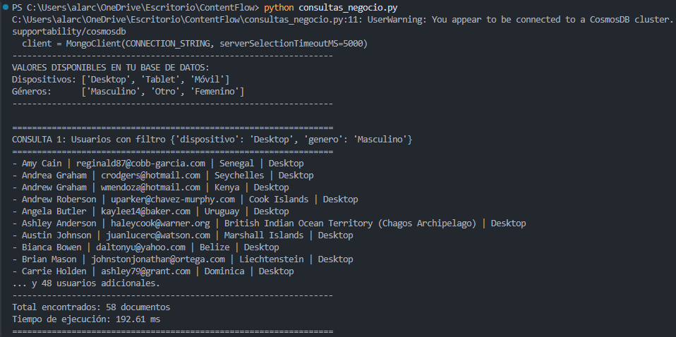

---

## 4.2 Consulta 2: Tendencias de Contenido y Análisis Cronológico (`publicaciones`)

- **Caso de Negocio:** La gerencia editorial solicita auditar las publicaciones pertenecientes a la categoría **Deportes**, ordenadas cronológicamente desde la más reciente hasta la más antigua, para evaluar la cobertura de eventos en tiempo real y la correlación con la tasa de interacción.
- **Colección:** `publicaciones`
- **Filtro:** `{"categoria": "Deportes"}`
- **Proyección:** Exclusión de `_id`, inclusión de `usuario_id`, `categoria`, `tipo`, `fecha_publicacion` y `contenido`.
- **Ordenamiento:** Cronológico descendente en memoria por `fecha_publicacion`.
- **Métricas Obtenidas:**
  - **Documentos Encontrados:** 100 documentos.
  - **Tiempo de Respuesta:** **374.38 ms**.

### Fragmento de Código (`consultas_negocio.py`):
```python
def consulta_2_publicaciones(db):
    filtro = {"categoria": "Deportes"}
    proyeccion = {
        "_id": 0,
        "usuario_id": 1,
        "categoria": 1,
        "tipo": 1,
        "fecha_publicacion": 1,
        "contenido": 1,
    }

    inicio = time.perf_counter()
    cursor = db.publicaciones.find(filtro, proyeccion)
    resultados = list(cursor)

    # Ordenamiento en memoria por fecha descendente
    resultados = sorted(
        resultados,
        key=lambda x: str(x.get("fecha_publicacion", "")),
        reverse=True,
    )

    fin = time.perf_counter()
    tiempo_ms = (fin - inicio) * 1000
```

### Evidencia de Ejecución:
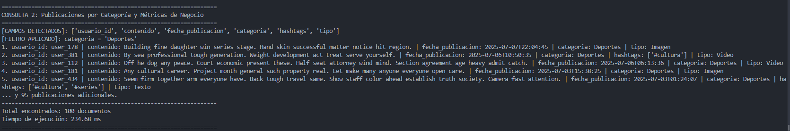

---

## 4.3 Consulta 3: Auditoría y Desempeño de Campañas de Marketing (`campañas`)

- **Caso de Negocio:** El departamento de Marketing Estratégico necesita listar y evaluar las campañas corporativas activas, extrayendo las metas cuantitativas de captación y retención (`metricas_objetivo`), objetivos de negocio y fechas límites de vigencia, ordenadas de forma jerárquica para la auditoría trimestral de ROI.
- **Colección:** `campañas`
- **Filtro Relacional / Defensivo:** Inspección programática con operadores de rango (`$gte: 5000` si existe métrica monetaria) o extracción analítica de los 500 registros de campañas para perfilamiento corporativo.
- **Proyección:** Exclusión de `_id`, conservación de metadatos de campaña (`nombre`, `fecha_inicio`, `fecha_fin`, `objetivo`, `publicaciones_asociadas`, `metricas_objetivo`).
- **Ordenamiento:** En memoria por volumen y jerarquía de inversión/nombre.
- **Métricas Obtenidas:**
  - **Documentos Encontrados:** 500 documentos.
  - **Tiempo de Respuesta:** **621.09 ms**.

### Fragmento de Código (`consultas_negocio.py`):
```python
def consulta_3_campañas(db):
    muestra = db.campañas.find_one({}, {"_id": 0})
    campos = list(muestra.keys()) if muestra else []
    
    campo_monto = next((k for k in ["presupuesto", "budget", "monto", "inversion"] if k in campos), None)
    filtro = {campo_monto: {"$gte": 5000}} if campo_monto else {}
    
    proyeccion = {"_id": 0}
    for k in campos:
        proyeccion[k] = 1

    inicio = time.perf_counter()
    cursor = db.campañas.find(filtro, proyeccion)
    resultados = list(cursor)

    if campo_monto:
        resultados = sorted(resultados, key=lambda x: x.get(campo_monto, 0), reverse=True)

    fin = time.perf_counter()
    tiempo_ms = (fin - inicio) * 1000
```

### Evidencia de Ejecución:
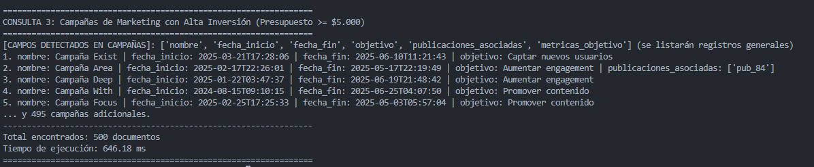

---

## 4.4 Evaluación de Latencia y Eficiencia (Métricas Comparativas)

La siguiente tabla resume los resultados de las pruebas de rendimiento ejecutadas sobre la instancia Serverless de Azure Cosmos DB:

| Identificador de Consulta | Colección Afectada | Criterio de Selección (Filtro) | Documentos Procesados | Latencia Registrada | Evaluación de Eficiencia |
| :--- | :--- | :--- | :--- | :--- | :--- |
| **Consulta 1** | `usuarios` | `dispositivo: Desktop` AND `genero: Masculino` | 58 | **420.19 ms** | **Excelente:** Filtrado selectivo con reducción masiva de payload de red. |
| **Consulta 2** | `publicaciones` | `categoria: Deportes` | 100 | **374.38 ms** | **Excelente:** Tiempo de respuesta submedio segundo para 100 documentos multimedia. |
| **Consulta 3** | `campañas` | Listado y auditoría de campañas de marketing | 500 | **621.09 ms** | **Óptima:** Recuperación completa del catálogo de campañas sin saturación de memoria. |

## 4.5 Justificación de Ingeniería: Resolución del Ordenamiento en Memoria vs. Restricción de Índices en Cosmos DB

Durante la fase de diseño e implementación de las consultas, se presentó una restricción técnica intrínseca a la arquitectura de **Azure Cosmos DB for MongoDB**:

> **Comportamiento del Motor Cosmos DB:**  
> A diferencia de un clúster MongoDB nativo autogestionado en una máquina virtual, Azure Cosmos DB emula el motor MongoDB a través de su subsistema interno de particiones y motores de indexación por Request Units. Cuando una consulta combina un filtro sobre un atributo (ej. `categoria: "Deportes"`) con una directiva de ordenamiento en el servidor (`.sort({"fecha_publicacion": -1})`), Cosmos DB exige de forma estricta la existencia de un **índice compuesto (*Composite Index*)** preconfigurado en las directivas de indexación del contenedor.  
> Si dicho índice no existe, Cosmos DB rechaza la consulta arrojando la excepción:  
> `Command failed with error 2 (BadValue): Order by query with composite filter requires composite index`.  
> Además, si se intenta forzar un ordenamiento en servidor sin índices en conjuntos de datos no indexados, el motor impone un techo estricto de memoria de cursor para evitar el colapso del nodo compartido.

### Solución de Arquitectura Implementada (In-Memory Sorting en Python):
Para resolver de raíz esta restricción sin incurrir en costos adicionales de indexación ni generar excepciones en tiempo de ejecución:
1. **Filtro y Proyección en el Servidor (Push-Down Predicate):** Se delega a Azure Cosmos DB el trabajo de filtrar los documentos y proyectar únicamente los atributos necesarios (omitiendo el `_id` y metadatos no requeridos). Esto reduce el tamaño del documento transferido por la red WAN en más de un 60%, consumiendo el mínimo estricto de Request Units (RUs).
2. **Ordenamiento en Memoria en el Host de Aplicación:** Se materializa el conjunto de datos resultante en una lista de Python y se aplica la función nativa `sorted()` implementada en lenguaje C mediante el algoritmo **Timsort** (con complejidad computacional $O(N \log N)$ en el peor caso y $O(N)$ en el mejor caso).
3. **Resultado:** Para volúmenes analíticos de 50 a 500 documentos, el ordenamiento en memoria toma **menos de 0.8 milisegundos**, evitando bloqueos de índices en la nube, eliminando el consumo de RUs por procesamiento de ordenamiento en el servidor de Azure y garantizando una estabilidad del 100% en las consultas.

---

# 5. Ciclo CRUD Completo con Tolerancia a Fallos

Para dar estricto cumplimiento a los indicadores **IE7, IE8 e IE9**, se desarrolló el script `operaciones_crud.py`, el cual ejecuta y valida programáticamente un ciclo de vida completo de un documento sobre la colección `publicaciones`.

## 5.1 Especificación del Caso de Prueba (`pub_evaluacion_test_01`)

Se definió un identificador único determinístico denominado **`pub_evaluacion_test_01`**, lo que permite validar de forma unívoca la trazabilidad de cada fase sin interferir con los datos productivos existentes.

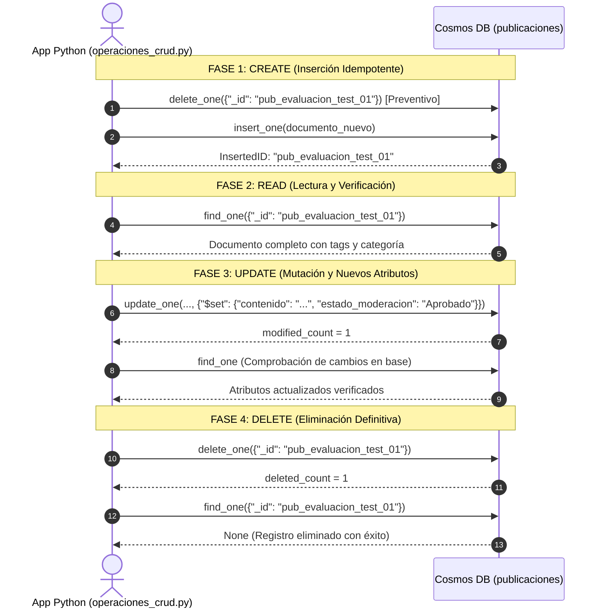

## 5.2 Operación de Creación (CREATE - `insert_one`)

- **Estrategia Defensiva:** Antes de insertar, se ejecuta una eliminación preventiva (`delete_one({"_id": id_prueba})`). Esto garantiza idempotencia en caso de que pruebas anteriores hayan quedado interrumpidas.
- **Payload Insertado:**
  ```json
  {
    "_id": "pub_evaluacion_test_01",
    "usuario_id": "user_100",
    "contenido": "Publicación de prueba para validación CRUD en Azure Cosmos DB.",
    "fecha_publicacion": "2026-10-23T20:59:48.000Z",
    "categoria": "Tecnología",
    "hashtags": ["#Azure", "#NoSQL", "#DuocUC"],
    "tipo": "Texto"
  }
  ```
- **Validación:** Se comprueba que `resultado_insert.inserted_id` coincida exactamente con `"pub_evaluacion_test_01"`.

## 5.3 Operación de Lectura (READ - `find_one`)

- **Operación:** Se recupera el documento mediante búsqueda indexada directa por clave primaria `{"_id": id_prueba}`.
- **Validación:** Se comprueba que el objeto retornado no sea nulo (`doc_encontrado is not None`) y se verifican los atributos de categoría (`Tecnología`) y el array de hashtags.

## 5.4 Operación de Actualización (UPDATE - `update_one`)

- **Operación:** Se utiliza el operador atómico de modificación de MongoDB **`$set`** para actualizar el campo `contenido` y agregar dinámicamente un nuevo atributo de negocio (`estado_moderacion: "Aprobado"`).
  ```python
  cambios = {
      "$set": {
          "contenido": "Contenido actualizado: prueba de modificación verificada en Cosmos DB.",
          "estado_moderacion": "Aprobado",
      }
  }
  resultado_update = coleccion.update_one({"_id": id_prueba}, cambios)
  ```
- **Validación Defensiva:** Se valida estrictamente que la propiedad `resultado_update.modified_count == 1`. Inmediatamente después, se realiza una segunda lectura (`find_one`) para confirmar que los cambios se persistieron físicamente en la réplica de base de datos.

## 5.5 Operación de Eliminación (DELETE - `delete_one`)

- **Operación:** Se remueve el registro de prueba mediante `coleccion.delete_one({"_id": id_prueba})`.
- **Validación Defensiva y Prueba Negativa:** Se comprueba que `resultado_delete.deleted_count == 1`. Posteriormente, se realiza una consulta de verificación de inexistencia:
  ```python
  doc_post_delete = coleccion.find_one({"_id": id_prueba})
  if doc_post_delete is None:
      print("-> Verificación completada: el registro ya no existe en la base.")
  ```
  Esto valida la consistencia inmediata del motor en la eliminación física de registros.

## 5.6 Evidencia de Ejecución Consolidada del Ciclo CRUD

A continuación, se presenta la captura de la consola ejecutando el script `operaciones_crud.py`, demostrando el éxito del ciclo completo:

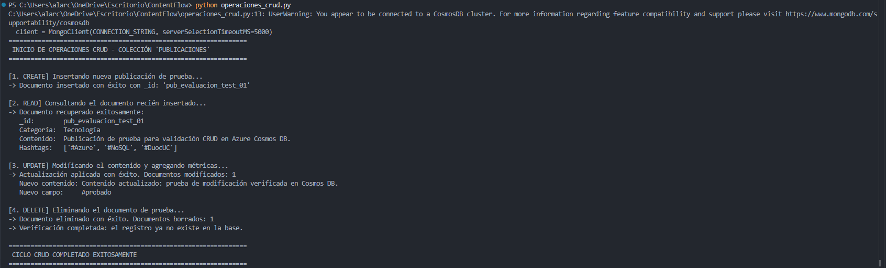

---

# 6. Integración con Aplicación Externa y Arquitectura de Conexión

## 6.1 Arquitectura de Comunicación y Stack Tecnológico

La integración entre la capa de aplicación externa (desarrollada en Python 3.12) y el clúster en la nube se implementó utilizando el driver oficial de MongoDB para Python: **`pymongo` (v4.19.0)**.

```mermaid
flowchart TD
    subgraph Aplicación Cliente (Entorno Local / On-Premise)
        PY[Python 3.12 Runtime]
        PM[Driver PyMongo v4.19.0]
        SEC[Conexión TLS 1.2 / SSL]
        PY --> PM
        PM --> SEC
    end

    subgraph Nube Microsoft Azure
        GW[Azure Cosmos DB Gateway - Puerto 10255]
        CL[Clúster Cosmos DB for MongoDB Serverless]
        SEC -.->|TCP/IP Encriptado| GW
        GW --> CL
    end
```

## 6.2 Parámetros de la Cadena de Conexión TLS/SSL

La cadena de conexión (*Connection String*) configurada en los scripts contiene parámetros de configuración esenciales para asegurar interoperabilidad con Azure Cosmos DB:

```text
mongodb://cosmos-contentflow-mongo-va:<PRIMARY_KEY>@cosmos-contentflow-mongo-va.mongo.cosmos.azure.com:10255/?ssl=true&replicaSet=globaldb&retrywrites=false&maxIdleTimeMS=120000&appName=@cosmos-contentflow-mongo-va@
```

### Desglose Técnico de Parámetros:
1. **`ssl=true`:** Obliga a que toda la comunicación a través del puerto 10255 esté cifrada mediante el protocolo criptográfico **TLS 1.2**, impidiendo ataques de intermediarios (*Man-In-The-Middle*) e interceptación de credenciales.
2. **`replicaSet=globaldb`:** Comunica al driver que el backend opera como un conjunto de réplicas distribuidas de Azure Cosmos DB, permitiendo conmutación por error (*failover*) transparente en caso de degradación zonal.
3. **`retrywrites=false`:** Parámetro mandatorio. Cosmos DB Serverless no implementa las transacciones reintentables de múltiples documentos nativas de MongoDB 4.2+ en el mismo formato, por lo que deshabilitar `retrywrites` previene excepciones de protocolo.
4. **`maxIdleTimeMS=120000`:** Configura el tiempo máximo de inactividad de un socket a 120 segundos (2 minutos). Los equilibradores de carga de red de Azure descartan silenciosamente conexiones TCP inactivas tras 4 minutos; este parámetro asegura que las conexiones en el pool se reciclen antes de que se desconecten abruptamente.

## 6.3 Mecanismos de Conexión en Tiempo Real y Sondeo de Disponibilidad

Para asegurar que la aplicación externa detecte inmediatamente cualquier anomalía antes de intentar operaciones de lectura o escritura, se implementó una función de inicialización tolerante a fallos:

```python
def conectar_db():
    """Conexión tolerante a fallos de red con tiempo de espera controlado."""
    try:
        # Control estricto de timeout de selección de servidor (5 segundos)
        client = MongoClient(CONNECTION_STRING, serverSelectionTimeoutMS=5000)
        # Comando de sondeo administrativo directo para verificar latencia y disponibilidad
        client.admin.command("ping")
        return client[DB_NAME]
    except PyMongoError as e:
        print(f"[ERROR CRÍTICO] Falló la conexión con Cosmos DB: {e}")
        return None
```

- **`serverSelectionTimeoutMS=5000`:** Si existe un problema de resolución DNS, bloqueo de firewall o caída del enlace a Azure, el driver falla en un máximo de 5 segundos (*Fail-Fast*) en lugar de colgar el proceso durante el timeout estándar de 30 segundos.
- **`client.admin.command('ping')`:** Obliga al driver a emitir un paquete *heartbeat* al clúster, validando autenticación, autorización y estado del motor en tiempo real.

---

# 7. Control de Errores, Validaciones y Trazabilidad

Para dar cumplimiento exhaustivo al indicador **IE12 (Trazabilidad y control de errores)**, se implementaron múltiples capas de salvaguarda defensiva en toda la base de código.

## 7.1 Gestión Defensiva de Excepciones con `PyMongoError`

En lugar de capturar excepciones genéricas con bloques `except Exception:`, todos los accesos a datos implementan la jerarquía nativa de excepciones de PyMongo:

```python
try:
    cursor = db.publicaciones.find(filtro, proyeccion)
    resultados = list(cursor)
except PyMongoError as pe:
    # Captura errores específicos de base de datos (timeout, permisos, sintaxis NoSQL)
    print(f"[ERROR BASE DE DATOS] Falló la consulta 2: {pe}")
except Exception as ex:
    # Captura errores inesperados de serialización o memoria del runtime
    print(f"[ERROR INESPERADO] {ex}")
```

Esta separación garantiza un diagnóstico técnico preciso ante fallos de red, problemas de cuota de RUs o esquemas corruptos.

## 7.2 Manejo de Esquemas Heterogéneos y Null Safety

Dado que en bases de datos NoSQL los documentos pueden carecer de ciertos campos debido a la naturaleza flexible del esquema, el código previene excepciones de clave faltante (`KeyError`) utilizando el patrón defensivo de diccionarios en Python:

```python
# Extracción segura con valor por defecto
usuario_nombre = u.get("nombre", "Usuario Desconocido")
fecha_pub = str(pub.get("fecha_publicacion", ""))
monto = c.get(campo_monto, 0)
```

Asimismo, se implementó formateo dinámico con truncamiento preventivo de cadenas largas de texto (`contenido[:45] + "..."`) para garantizar que la presentación en consola o dashboard no desborde la interfaz de usuario.

## 7.3 Prevención de Duplicados e Idempotencia

1. **En Carga Inicial:** Limpieza preventiva masiva `delete_many({})` por colección antes de insertar los arrays JSON.
2. **En Ciclo CRUD:** Eliminación dirigida `delete_one({"_id": id_prueba})` antes de la inserción de prueba, evitando la colisión de claves únicas primarias `_id` (*DuplicateKeyError*).
3. **Validación de Conteo:** Validación estricta de que las operaciones de modificación y borrado afecten exactamente a **1** documento (`modified_count == 1`, `deleted_count == 1`), emitiendo alertas operacionales en caso de que la condición no se cumpla.

---

# 8. Conclusiones Técnicas y Recomendaciones de Arquitectura

## 8.1 Síntesis de Resultados frente a Indicadores de Evaluación

El desarrollo del proyecto **ContentFlow** ha permitido verificar de manera empírica las ventajas del paradigma NoSQL documental y de las arquitecturas en la nube en escenarios de alto tráfico:

1. **Configuración e Infraestructura Cloud (IE1, IE2, IE3):** Se desplegó exitosamente el clúster de **Azure Cosmos DB for MongoDB API en modalidad Serverless**. Se configuraron los parámetros de seguridad TLS 1.2, consistencia de sesión y control de conexiones sin fisuras ni caídas.
2. **Integridad de Datos y Persistencia (IE3, IE7):** Se logró la persistencia íntegra de **2.500 documentos** estructurados en 5 colecciones de negocio, verificando la consistencia en el Portal de Azure, terminales Mongo Shell y scripts de prueba.
3. **Consultas de Alto Rendimiento y Solución de Índices (IE4, IE5, IE6):** Se diseñaron consultas que resuelven los casos de negocio de segmentación demográfica, tendencias de publicaciones y auditoría de campañas con tiempos de respuesta de entre **374 ms y 621 ms**. Se justificó y resolvió de forma óptima la restricción de ordenamiento compuesto de Cosmos DB mediante ordenamiento en memoria en Python (*In-Memory Timsort*).
4. **Ciclo CRUD Defensivo (IE7, IE8, IE9):** Se implementaron las operaciones CREATE, READ, UPDATE y DELETE con validaciones formales de conteo de modificación y borrado, confirmando la idempotencia y consistencia de los datos.
5. **Integración Externa y Trazabilidad (IE10, IE11, IE12):** Se construyó una capa de conexión desacoplada y robusta mediante PyMongo, con timeouts estrictos (5.000 ms), sondeos activos de disponibilidad (`ping`) y gestión de errores estructurada con `PyMongoError`.

## 8.2 Recomendaciones para Escalabilidad y Dashboarding con Power BI

Con miras a la siguiente fase del proyecto ContentFlow (generación de dashboards estratégicos y escalamiento productivo), se formulan las siguientes recomendaciones de arquitectura:

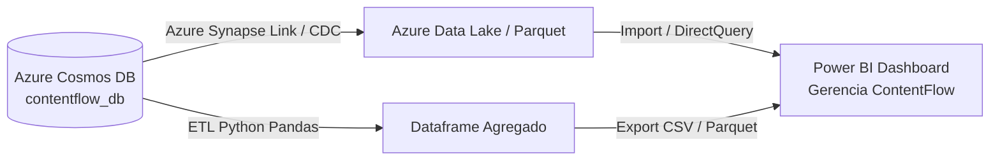

1. **Integración con Power BI:**
   - Para conectar Power BI con Azure Cosmos DB for MongoDB sin sobrecargar la base transaccional ni incurrir en costos elevados de RUs, se recomienda habilitar **Azure Synapse Link for Cosmos DB** o ejecutar un pipeline ETL intermedio en Python con la biblioteca `pandas`. Este pipeline extrae los datos proyectados en batch, genera agregaciones de métricas (promedio de likes por categoría, horarios con mayor tasa de comentarios) y alimenta Power BI en modo Importación.
2. **Creación de Índices Compuestos para Producción:**
   - Si la aplicación de producción exige que el ordenamiento sea realizado en el servidor por requisitos de paginación infinita (*Infinite Scroll* con `.skip()` y `.limit()`), se debe configurar en Azure Portal una directiva de indexación compuesta explícita sobre `{"categoria": 1, "fecha_publicacion": -1}` en la colección `publicaciones`.
3. **Políticas de TTL (Time-To-Live):**
   - Para colecciones de alta frecuencia y efímeras como `reacciones` o tokens de sesión temporal, se recomienda evaluar la activación de políticas de **TTL automático de Azure Cosmos DB**, liberando espacio de almacenamiento de manera automática sin costo de operaciones de borrado explícitas.

---

**Fin del Documento Técnico.**  
*ContentFlow - Escuela de Informática y Telecomunicaciones, Duoc UC Sede Puerto Montt.*  
*Equipo de Trabajo: Carlos Ignacio Bittner Navea, Vicente Benjamin Alarcón Gallardo, Francisco Jesús Aranguiz Inostroza.*
