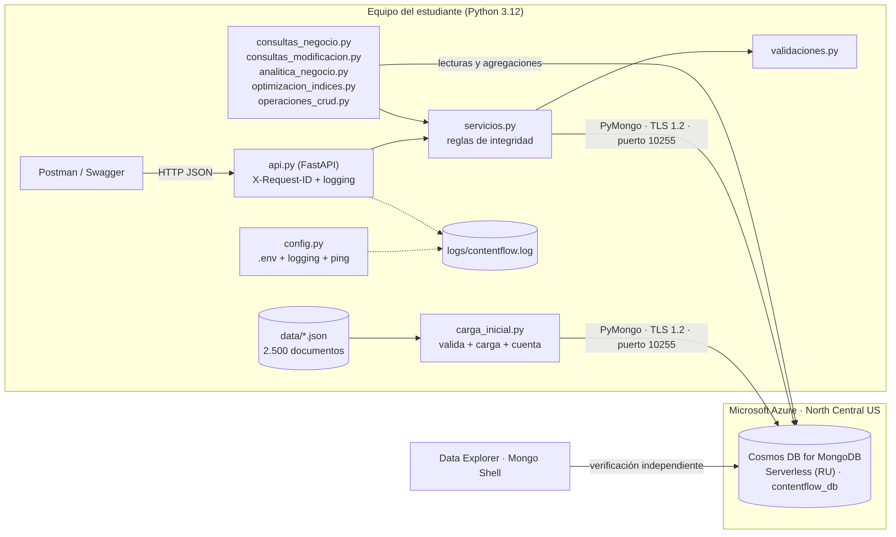

# ContentFlow · NoSQL en Azure Cosmos DB for MongoDB

Evaluación Parcial N°2 (40%) · BDY0101 Base de Datos No Relacionales · Duoc UC Sede Puerto Montt · Caso **ContentFlow (Forma A)**

**Equipo:** Carlos Ignacio Bittner Navea · Vicente Benjamin Alarcón Gallardo · Francisco Jesús Aranguiz Inostroza

Plataforma de contenidos (usuarios, publicaciones, reacciones, comentarios y campañas) sobre **Azure Cosmos DB for MongoDB (Serverless, RU)**, con consultas de negocio, CRUD multi-colección con reglas de integridad, una **API REST** (FastAPI) y evidencia de integración con Postman.



---

## 1. Puesta en marcha

```bash
git clone https://github.com/ChenteDev1/ContentFlow.git
cd ContentFlow
python -m venv venv
venv\Scripts\activate            # Windows  (Linux/Mac: source venv/bin/activate)
pip install -r requirements.txt

copy .env.example .env           # Linux/Mac: cp .env.example .env
# edita .env y reemplaza <PRIMARY_KEY> (Azure Portal > Cosmos DB > Cadenas de conexión)
```

> `.env` está en `.gitignore`: **la clave nunca debe subirse a GitHub**. Tampoco la muestres en capturas.

## 2. Orden de ejecución (con la evidencia que debe quedar guardada)

| # | Comando | Qué hace | Captura sugerida (`Evidencias/`) |
|---|---------|----------|----------------------------------|
| 1 | `python carga_inicial.py --solo-validar` | Revisa los 5 JSON sin tocar la base | – |
| 2 | `python carga_inicial.py` | Valida, vacía y carga 2.500 documentos; cuenta lo insertado | `PoblacionBasedeDatos.png` *(ya existe)* |
| 3 | `python integridad.py` | Auditoría: huérfanos, duplicados, fechas incoherentes | `Integridad_Auditoria.png` |
| 4 | `python consultas_negocio.py` | 5 consultas de lectura (filtro, proyección, orden) con tiempo, bytes y RU | `Consultas_Lectura.png` |
| 5 | `python consultas_modificacion.py` | 4 modificaciones (`$set`, `$addToSet`, `$inc`, …) con verificación y reversión | `Consultas_Modificacion.png` |
| 6 | `python analitica_negocio.py --exportar` | Usuarios activos, contenido popular, horarios, impacto de campañas + CSV para Power BI | `Analitica.png` |
| 6b | `python generar_dashboard.py` → abrir `dashboard/index.html` | Panel HTML con los gráficos del caso (`--local` si no hay Azure) | `Dashboard_Panel.png` |
| 7 | `python optimizacion_indices.py` | Mide antes/después de proyección, lotes e índices (IE6) | `Optimizacion_Indices.png` |
| 8 | `python operaciones_crud.py` | CRUD completo en 5 colecciones + 12 casos inválidos + limpieza | `CRUD_Escenario.png` |
| 9 | `uvicorn api:app --port 8000` | Levanta la API (Swagger en `http://127.0.0.1:8000/docs`) | `API_Swagger.png` |
| 10 | Postman → importar `postman/ContentFlow.postman_collection.json` → **Run collection** | Lectura/escritura en tiempo real contra Azure | `Postman_Run.png`, `Postman_Request_*.png` |
| 11 | `python generar_informe.py` | Arma el informe con los resultados reales y genera el PDF | – |

Además, verifica **por una vía independiente** (IE3): Data Explorer de Azure y Mongo Shell (ya hay capturas) y el endpoint `GET /salud`.

Los resultados de cada script se guardan en `resultados/*.json` y los CSV para Power BI en `exportes/`. El log de todo lo ejecutado queda en `logs/contentflow.log`.

## 3. Estructura

```
config.py                  .env, logging (consola + archivo) y conexión con timeout y ping
validaciones.py            reglas de entrada (categorías, fechas, hashtags, correo, campos inmutables…)
servicios.py               CRUD con reglas de integridad (existencia, fechas, duplicados, cascada)
carga_inicial.py           carga idempotente: valida JSON → vacía → inserta → cuenta
integridad.py              auditoría y corrección segura de calidad de datos
consultas_negocio.py       5 consultas de lectura
consultas_modificacion.py  4 consultas de modificación (reversibles)
analitica_negocio.py       analítica del caso + exportación CSV
generar_dashboard.py       genera dashboard/index.html (panel de gráficos, un solo archivo)
dashboard/                 plantilla.html + index.html (se abre con doble clic)
GUIA_DEL_PROYECTO.md       resumen simple: qué es, cómo cumple la pauta, qué falta
optimizacion_indices.py    experimentos de eficiencia (tiempo, volumen, RU)
metricas.py                medición (mediana de repeticiones, bytes BSON, RU de Cosmos)
operaciones_crud.py        escenario CRUD multi-colección
api.py                     API REST (FastAPI)
postman/                   colección y entorno de Postman
tests/                     51 pruebas automáticas (no requieren Azure)
generar_informe.py         construye el PDF a partir de informe/INFORME_TECNICO_CONTENTFLOW.md
data/                      los 5 JSON del caso (2.500 documentos)
Evidencias/                capturas
```

## 4. Pruebas automáticas (sin Azure)

```bash
python -m pytest -q
```

Usan una base simulada (`mongomock`) cargada con los JSON reales: validan la **lógica** (consultas, reglas, CRUD, API). Los tiempos y RU **solo son válidos contra Azure** (pasos 4–10).

## 5. Endpoints principales de la API

| Método | Ruta | Descripción |
|--------|------|-------------|
| GET | `/salud` | Ping a Cosmos DB, latencia y conteos |
| GET | `/publicaciones?categoria=&tipo=&limite=&pagina=` | Lista paginada (más recientes primero) |
| GET / PUT / DELETE | `/publicaciones/{id}` | Leer / modificar / eliminar en cascada |
| POST | `/publicaciones`, `/usuarios`, `/reacciones`, `/comentarios` | Crear (validación + reglas de integridad) |
| POST | `/comentarios/{id}/like` | `$inc` atómico |
| POST | `/campanas/{cid}/publicaciones/{pid}` | Asociar publicación (`$addToSet`) |
| GET | `/campanas`, `/analitica/*` | Campañas y analítica |

Errores controlados: `422` validación · `404` no existe · `409` regla de negocio / duplicado · `503` base no disponible. Cada respuesta incluye `X-Request-ID` (también en el log).

## 6. Notas importantes

* **Claves de partición:** por defecto las colecciones se crean *sin* shard key (≈0,66 MB de datos). `python carga_inicial.py --shard-key` **recrea** las colecciones con una clave de partición propuesta (experimental: verifica en Data Explorer > Settings y repite los pasos 4–10).
* **Orden en el servidor:** Cosmos DB necesita índice para `sort`. El código intenta ordenar en el servidor y, si lo rechaza, ordena en memoria y lo deja en el log. `optimizacion_indices.py` crea los índices y mide la mejora.
* **Calidad de datos:** el dataset tiene fechas incoherentes (p. ej. 245 reacciones anteriores a su publicación). `integridad.py` las detecta; con `--aplicar` las **marca** (`revision_temporal`) y elimina 1 reacción duplicada.
* Informe técnico: `informe/INFORME_TECNICO_CONTENTFLOW.md` → PDF generado con `generar_informe.py`.
