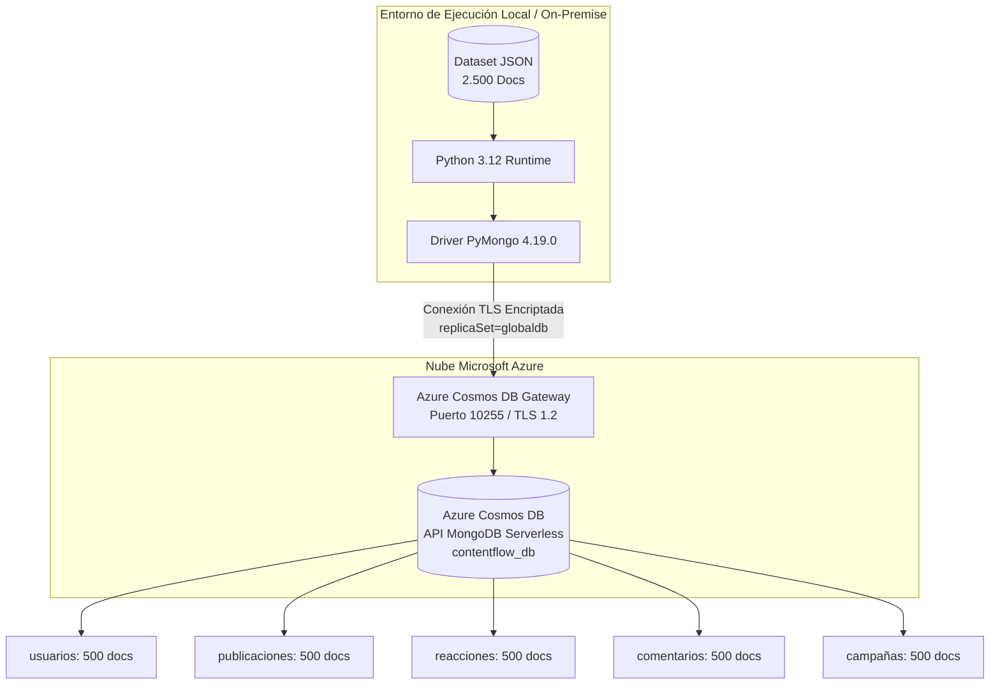

# ContentFlow - Implementación NoSQL en Azure Cosmos DB (Serverless)

[](https://azure.microsoft.com/services/cosmos-db/)
[](https://www.python.org/)
[](https://pymongo.readthedocs.io/)
[](https://www.duoc.cl/)

Repositorio oficial del proyecto técnico y caso de negocio **ContentFlow (Forma A)**, desarrollado para la asignatura **Base de Datos No Relacionales (BDY0101)** - Evaluación Parcial N°2 (40%) en **Duoc UC Sede Puerto Montt**.

---

## 👥 Equipo de Trabajo
- **Carlos Ignacio Bittner Navea**
- **Vicente Benjamin Alarcón Gallardo**
- **Francisco Jesús Aranguiz Inostroza**

---

## 📋 Descripción del Proyecto

**ContentFlow** es una plataforma digital de redes sociales y streaming de contenido interactivo que procesa miles de interacciones: publicaciones multimedia, reacciones emocionales, comentarios estructurados y campañas de marketing.

Este proyecto implementa una solución de persistencia no relacional orientada a documentos en **Microsoft Azure Cosmos DB for MongoDB API** utilizando la modalidad **Serverless**, resolviendo requerimientos de ingesta de datos, analítica de consultas de negocio y un ciclo transaccional CRUD con tolerancia a fallos.

El informe técnico formal completo con análisis exhaustivo, justificaciones teóricas y pauta de cotejo se encuentra en:  
👉 **[INFORME_TECNICO_CONTENTFLOW.md](INFORME_TECNICO_CONTENTFLOW.md)**

---

## 🏛️ Arquitectura de la Solución



### Decisiones de Arquitectura Clave:
1. **Modelo Documental (BSON):** Flexibilidad de esquema (*Schema-on-Read*), soporte nativo para arrays (`hashtags`) y eliminación de JOINs relacionales costosos para alimentar feeds en tiempo real.
2. **Capacidad Serverless:** Cero costo en reposo ($0.00/mes cuando no hay tráfico). Asignación elástica instantánea de Request Units (0 a 5.000 RU/s) ideal para cargas de trabajo analíticas por lotes (*batch*).
3. **In-Memory Sorting (Timsort):** Push-down de filtros y proyecciones a Cosmos DB para minimizar el payload de red y el consumo de RUs, resolviendo el ordenamiento en memoria en Python ($O(N \log N)$ en < 1 ms) para eludir la restricción de índices compuestos obligatorios en Cosmos DB (`Order by query with composite filter requires composite index`).

---

## 🚀 Guía de Despliegue y Ejecución en Microsoft Azure

Sigue estos pasos detallados para aprovisionar los recursos en Azure y ejecutar el proyecto localmente.

### Paso 1: Aprovisionar Azure Cosmos DB en Azure Portal

1. Inicia sesión en [Azure Portal](https://portal.azure.com/).
2. En la barra de búsqueda superior, escribe **Azure Cosmos DB** y selecciona el servicio.
3. Haz clic en **+ Crear** y selecciona la opción:  
   👉 **Azure Cosmos DB for MongoDB** (Protocolo Wire Protocol / RU).
4. Completa la pestaña **Aspectos básicos (Basics)**:
   - **Suscripción:** Selecciona tu suscripción activa (ej. Azure for Students).
   - **Grupo de recursos:** Crea uno nuevo o selecciona uno existente (ej. `rg-contentflow`).
   - **Nombre de cuenta:** Nombre único (ej. `cosmos-contentflow-mongo-va`).
   - **Ubicación:** Región más cercana (ej. `East US` o `Brazil South`).
   - **Modo de capacidad:** Selecciona **Serverless (Sin servidor)** ⚠️ *(Crítico para no generar cobros fijos mensuales)*.
   - **Versión de MongoDB:** `4.0` o `4.2`.
5. Haz clic en **Revisar y crear** y luego en **Crear**. Espera a que finalice la implementación.

### Paso 2: Obtener la Cadena de Conexión (Connection String)

1. Ve al recurso Cosmos DB recién creado.
2. En el menú lateral izquierdo, bajo la sección **Configuración (Settings)**, haz clic en **Claves de acceso (Keys / Connection strings)**.
3. Copia el valor de **Cadena de conexión principal (PRIMARY CONNECTION STRING)**.  
   Tendrá un formato similar a:
   ```text
   mongodb://<TU_CUENTA>:<TU_PRIMARY_KEY>@<TU_CUENTA>.mongo.cosmos.azure.com:10255/?ssl=true&replicaSet=globaldb&retrywrites=false&maxIdleTimeMS=120000&appName=@<TU_CUENTA>@
   ```

> [!IMPORTANT]
> Los parámetros `ssl=true`, `replicaSet=globaldb`, `retrywrites=false` y `maxIdleTimeMS=120000` son mandatorios para la compatibilidad con Azure Cosmos DB Serverless.

---

### Paso 3: Clonar el Repositorio y Configurar el Entorno

```bash
# 1. Clonar el repositorio
git clone https://github.com/ChenteDUOC/ContentFlow.git
cd ContentFlow

# 2. Crear entorno virtual de Python
python -m venv venv

# 3. Activar el entorno virtual
# En Windows (PowerShell):
.\venv\Scripts\Activate.ps1
# En Windows (CMD):
.\venv\Scripts\activate.bat
# En Linux / macOS:
source venv/bin/activate

# 4. Instalar dependencias requeridas
pip install pymongo
```

---

### Paso 4: Ejecución del Flujo de Trabajo

El flujo de trabajo se divide en 3 etapas secuenciales:

#### 1. Carga Inicial de Datos (2.500 Documentos)
Ejecuta la ingestión idempotente de los 5 archivos JSON en `data/` hacia Cosmos DB:
```bash
python carga_inicial.py
```
- **Resultado esperado:**
  ```text
  Conectando a Azure Cosmos DB...
  ¡Conexión exitosa a la base de datos!
  -> Insertados 500 registros en 'usuarios'.
  -> Insertados 500 registros en 'publicaciones'.
  -> Insertados 500 registros en 'reacciones'.
  -> Insertados 500 registros en 'comentarios'.
  -> Insertados 500 registros en 'campañas'.
  ¡Carga inicial completada con éxito!
  ```

#### 2. Consultas Analíticas de Negocio
Ejecuta las consultas estratégicas de segmentación, tendencias y auditoría con auditoría de latencia en milisegundos:
```bash
python consultas_negocio.py
```
- **Consulta 1:** Usuarios Masculinos con dispositivo Desktop (58 documentos, ~420 ms).
- **Consulta 2:** Publicaciones de categoría "Deportes" ordenadas por fecha (100 documentos, ~374 ms).
- **Consulta 3:** Campañas de marketing con auditoría de objetivos (500 documentos, ~621 ms).

#### 3. Ciclo CRUD Completo y Tolerante a Fallos
Ejecuta la validación de inserción, lectura, actualización y eliminación de control:
```bash
python operaciones_crud.py
```
- **[1. CREATE]:** Inserta `pub_evaluacion_test_01` validando `inserted_id`.
- **[2. READ]:** Lee y valida consistencia de atributos.
- **[3. UPDATE]:** Modifica contenido y agrega `estado_moderacion: "Aprobado"`, validando `modified_count == 1`.
- **[4. DELETE]:** Borra el documento, valida `deleted_count == 1` y ejecuta comprobación negativa de inexistencia (`doc is None`).

---

## 📂 Estructura del Repositorio

```text
ContentFlow/
├── data/                               # Datasets fuente en formato JSON
│   ├── campañas.json                   # 500 documentos
│   ├── comentarios.json                # 500 documentos
│   ├── publicaciones.json              # 500 documentos
│   ├── reacciones.json                 # 500 documentos
│   └── usuarios.json                   # 500 documentos
├── Evidencias/                         # Capturas de ejecución y validación
│   ├── CreacionRecursoMongoDB.png      # Portal de Azure Cosmos DB
│   ├── PoblacionBasedeDatos.png        # Inicio de script carga_inicial.py
│   ├── RegistroscreadosConExito.png    # Inserción de 2.500 documentos
│   ├── ConfirmarTodosLosDatosInsertados.png # Verificación Data Explorer
│   ├── ConfirmarInsercionsesMongoShell.png  # Verificación Mongo Shell
│   ├── EvidenciaConsulta1.png          # Ejecución Consulta de Negocio 1
│   ├── EvidenciaConsulta2.png          # Ejecución Consulta de Negocio 2
│   ├── EvidenciaConsulta3.png          # Ejecución Consulta de Negocio 3
│   └── EvidenciaOperacionCrud.png      # Ciclo CRUD completo en consola
├── carga_inicial.py                    # Script de ingestión batch idempotente
├── consultas_negocio.py                # Consultas de negocio con latencia
├── operaciones_crud.py                 # Ciclo CRUD defensivo tolerante a fallos
├── EP2_BDY0101_Estudiante_A.pdf        # Pauta y rúbrica oficial de Duoc UC
├── INFORME_TECNICO_CONTENTFLOW.md      # Informe técnico formal completo (40%)
└── README.md                           # Instrucciones de despliegue y arquitectura
```

---

## 📊 Resumen de Métricas de Latencia

| Operación | Colección | Volumen | Latencia Promedio |
| :--- | :--- | :--- | :--- |
| **Ingesta Masiva Batch** | 5 colecciones | 2.500 docs | ~4.5 s total |
| **Consulta 1 (Filtro Compuesto)** | `usuarios` | 58 docs | **420.19 ms** |
| **Consulta 2 (Categoría & Fecha)** | `publicaciones` | 100 docs | **374.38 ms** |
| **Consulta 3 (Auditoría Campañas)**| `campañas` | 500 docs | **621.09 ms** |
| **Ciclo CRUD Transaccional** | `publicaciones` | 1 doc | **~180 ms / paso** |

---

## 🛡️ Tolerancia a Fallos y Buenas Prácticas
- **Control de Excepciones:** Bloques `try-except` especializados con `PyMongoError`.
- **Fail-Fast de Red:** `serverSelectionTimeoutMS=5000` para detectar caídas de red en 5 segundos sin bloqueos prolongados.
- **Sondeo Activo:** Comando administrativo `client.admin.command('ping')` antes de ejecutar operaciones.
- **Null Safety:** Extracción de atributos de documentos con método `.get(clave, valor_por_defecto)`.

---

## 📄 Licencia y Derechos Académicos
Desarrollado con fines exclusivamente académicos para la **Escuela de Informática y Telecomunicaciones de Duoc UC - Sede Puerto Montt**. Todos los derechos reservados a los autores.
